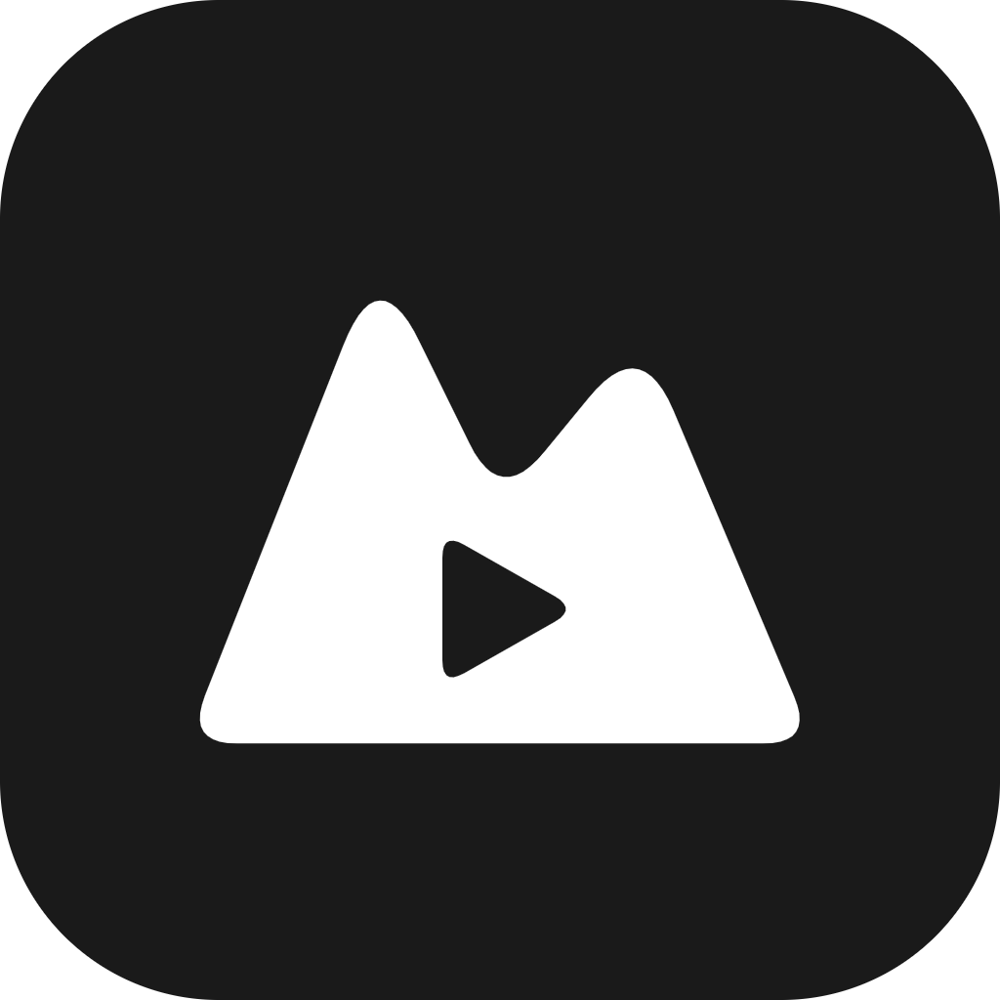

<div align="center">



# Mestia

**Download. Keep. Watch.**<br/>
Video and music from 1800+ sites — in a library with its own player. For desktop and phone.

[](https://github.com/kweharmony/Mestia/releases/latest)
[](LICENSE)


[Русский](README.md) · **English** · [Website](https://kweharmony.github.io/Mestia/?lang=en)

<a href="docs/media/promo.en.mp4"></a>

</div>

---

## Features

**Downloading**
- Links from **1800+ sites** — everything [yt-dlp](https://github.com/yt-dlp/yt-dlp) supports: YouTube, VK, Rutube, TikTok, SoundCloud…
- Video up to 4K or audio (MP3, M4A, OPUS, FLAC, WAV); **playlists** in full or picked items (`1-5, 8`).
- Background queue, **one progress for the final file** (video and audio counted together),
  intermediate files never show up in the library, interrupted downloads resume.
- Spotify and Apple Music — the track is found and downloaded from YouTube by title.

**Library & player**
- Folders, thumbnails, drag-and-drop, multi-select, search; changes on disk are picked up automatically.
- Player with controls over the frame, audio as a cover-art card; remembers the position of every file.
- **Ctrl+K** command palette: paste a link, find a file, switch theme, jump to a section.

**Android**
- **Media notification** with cover art and buttons, playback with the screen off.
- Download progress in the notification; “**Share → Download with Mestia**” from YouTube and the browser.

**Nearby** — no internet needed
- Send files desktop ↔ phone over Wi-Fi or a hotspot, with receive confirmation.
- **Watch together**: synced playback with a queue, streamed from the host device.

**Look & feel**
- 8 themes; the app icon follows the theme (on Android, the home-screen icon too).
- Interface in English, Russian and Chinese.

## Download

| Platform | File | Status |
|---|---|---|
| **Windows 10/11** | `Mestia_*_x64-setup.exe` | ✅ tested, auto-updates |
| **Linux** | `.AppImage`, `.deb`, `Mestia.flatpak` | ⚠️ experimental |
| **Android 11+** | `*_android_arm64.apk` (almost every phone), `*_android_armv7.apk` | ⚠️ experimental |
| **macOS** | `.dmg` (universal) | ⚠️ experimental, not notarized |

👉 **[Latest release](https://github.com/kweharmony/Mestia/releases/latest)**. Not on Google Play: YouTube downloaders aren't allowed there.

<details>
<summary><b>Linux: versions, codecs, tray</b></summary>

- `.deb`/AppImage are built on Ubuntu 22.04 and need **glibc ≥ 2.35** and **webkit2gtk-4.1**.
  On older distros use **Flatpak** — it ships its own runtime.
- Video won't play (“Couldn't play the file”) — install GStreamer codecs
  (`.deb` pulls them in, AppImage doesn't):
  ```bash
  sudo apt install gstreamer1.0-libav gstreamer1.0-plugins-good gstreamer1.0-plugins-bad gstreamer1.0-plugins-ugly
  ```
- The tray icon needs AppIndicator; without it (vanilla GNOME) there may be no tray icon — nothing else is affected.
</details>

<details>
<summary><b>Steam Deck (SteamOS)</b></summary>

There's no system WebKitGTK, so `.deb` won't install and AppImage shows a blank window. Use Flatpak:

```bash
flatpak install --user ./Mestia.flatpak
flatpak run com.mestia.app
```

For Game Mode, add Mestia to Steam as a non-Steam game with `flatpak run com.mestia.app`.
The built-in updater doesn't apply to Flatpak — update with `flatpak update`.
</details>

<details>
<summary><b>macOS: “app is damaged”</b></summary>

Builds are ad-hoc signed and not notarized, so Gatekeeper complains. Remove the quarantine once:

```bash
xattr -cr /Applications/Mestia.app
```
</details>

<details>
<summary><b>Android: good to know</b></summary>

- yt-dlp, Python and ffmpeg are bundled via [youtubedl-android](https://github.com/JunkFood02/youtubedl-android) (GPL-3.0).
  The first launch takes a bit longer while Python unpacks.
- Files go to **Downloads → Mestia** (you can pick another folder); video and music show up in the gallery.
- Not available: browser cookies, tray, mini window, self-update (new versions are APKs from releases).
  The yt-dlp engine updates from Settings.
</details>

## Supported sites

Everything in [yt-dlp's list](https://github.com/yt-dlp/yt-dlp/blob/master/supportedsites.md) — video hosts, social networks,
audio platforms, direct mp4/m3u8 links. Spotify and Apple Music go through YouTube search;
Zvuk and VK Music by a title you type in. DRM services (Netflix, Disney+, Prime Video, Hulu, Yandex Music…)
can't be downloaded — the app says so right away. Private and age-restricted videos work with browser
cookies (Settings, desktop only); geo-blocks — via a proxy.

## Privacy

No telemetry, analytics or accounts — everything stays on your device. Details: [PRIVACY.md](PRIVACY.md).

## Building from source

You need **Node.js 18+**, **Rust (stable)** and the [Tauri system dependencies](https://tauri.app/start/prerequisites/).

```bash
npm install
npm run fetch-binaries   # yt-dlp + ffmpeg/ffprobe for your OS → src-tauri/binaries/
npm run tauri dev        # run in development mode
npm run tauri build      # installers → src-tauri/target/release/bundle/
```

| Task | Command |
|---|---|
| Type-check + frontend build | `npm run build` |
| Frontend tests (Vitest) | `npm test` |
| Rust tests | `cargo test` (in `src-tauri/`) |
| Android: dev / APK | `npm run tauri android dev` / `npm run tauri android build -- --apk` |

<details>
<summary><b>More: Windows, Linux, Android, releases</b></summary>

- **Windows:** Microsoft C++ Build Tools (`winget install Microsoft.VisualStudio.2022.BuildTools`), WebView2 (usually present).
- **Linux (Debian/Ubuntu):**
  ```bash
  sudo apt install libwebkit2gtk-4.1-dev build-essential curl wget file libssl-dev libayatana-appindicator3-dev librsvg2-dev
  ```
- **Android:** Android SDK + NDK, JDK 17+, `ANDROID_HOME` and `NDK_HOME`. The release APK is signed with the key
  from `src-tauri/gen/android/keystore.properties` (git-ignored); CI builds it from the
  `ANDROID_KEYSTORE_BASE64`, `ANDROID_KEYSTORE_PASSWORD`, `ANDROID_KEY_ALIAS` secrets.
  **Never lose or change the key** — otherwise updates won't install over the old version.
- **Release:** bump the version in `package.json` and `src-tauri/tauri.conf.json` (same value), push a `vX.Y.Z` tag.
  `.github/workflows/release.yml` builds and signs every OS and attaches `latest.json` for the updater;
  then publish the draft release. Updater signing uses `TAURI_SIGNING_PRIVATE_KEY` and `TAURI_SIGNING_PRIVATE_KEY_PASSWORD`.
- **Notarized macOS:** add `APPLE_CERTIFICATE`, `APPLE_CERTIFICATE_PASSWORD`, `APPLE_SIGNING_IDENTITY`, `APPLE_ID`,
  `APPLE_PASSWORD`, `APPLE_TEAM_ID` secrets — CI turns on signing and notarization.
</details>

## Where data lives

- Files — in the download folder (default `Documents/Mestia`, on Android `Downloads/Mestia`; change it in Settings).
  Unfinished parts live in a hidden `.mestia-tmp` next to it and are used to resume.
- `mestia.db` (library, history), settings and the thumbnail cache — in the app data folder.

## How it's built

Tauri v2 (Rust) + React 18 + TypeScript + Tailwind CSS v4, SQLite, yt-dlp and ffmpeg as sidecars;
on Android a Kotlin plugin on top of youtubedl-android. The module map and core flows are in
[`.context/index.md`](.context/index.md), development rules in [CLAUDE.md](CLAUDE.md).

The promo video is built from `design/promo/promo.html` by `design/promo/render.mjs`.

## Contributing

Bugs and ideas — [Issues](https://github.com/kweharmony/Mestia/issues/new/choose), code — see
[CONTRIBUTING.md](CONTRIBUTING.md). Vulnerabilities — privately, see [SECURITY.md](SECURITY.md).
[Code of Conduct](CODE_OF_CONDUCT.md).

## License

[MIT](LICENSE). The Android build includes [youtubedl-android](https://github.com/JunkFood02/youtubedl-android)
and as a whole is distributed under **GPL-3.0**. Bundled components: [yt-dlp](https://github.com/yt-dlp/yt-dlp) (Unlicense),
[FFmpeg](https://ffmpeg.org/legal.html) (LGPL/GPL).
